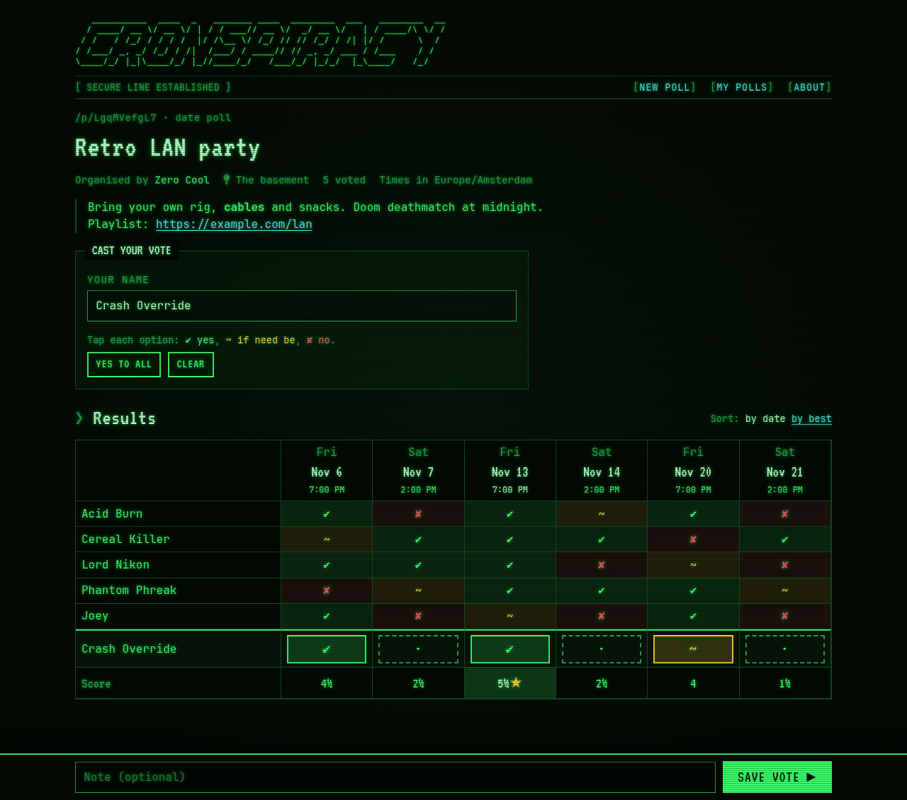
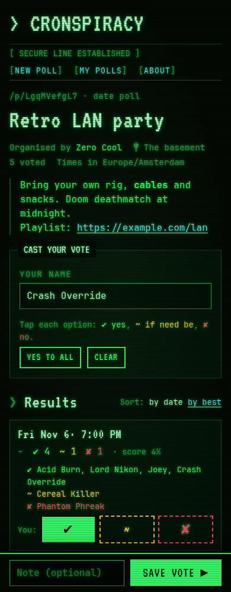

# Cronspiracy

> When can everyone make it? A self-hosted scheduling poll with no logins, styled like a 90s green-phosphor terminal.

You pick some dates, share the link, and everyone votes ✔ yes / ~ if need be / ✘ no from their phone. The best date
gets a ★. There are no accounts, no email, no cookies and no trackers: links are the only identity. It runs as one
container with one SQLite file.

<p align="center">
  
  &nbsp;
  
</p>

## Features

- **Fast date picking.** Choose a date range and weekday chips, or use quick picks ("Weekends this month"). A live
  calendar shows the result, and you can tap individual days to add or remove them. Time slots and plain text
  options are optional.
- **Voting in about 30 seconds.** On desktop it's a grid: tap a cell to cycle through the answers, or use the arrow
  keys. On phones it's a card per option with three big buttons. Counts and the ★ update live while you tap.
- **Links instead of accounts.**
  - The **share link** is for everyone who should vote.
  - The secret **admin link** is for the organiser.
  - A **personal edit link** lets a voter change their own vote on another device.
- **Organiser tools.** Edit the poll details, close or reopen voting, fix or delete anyone's row, and pick the final
  date. Picking it gives everyone `.ics`, Google and Outlook calendar links. You can also export results as CSV.
- **Privacy options.**
  - Keep votes secret until you've voted, so nobody gets swayed.
  - Hide names from other participants.
  - Set a voting deadline.
  - Polls delete themselves automatically 7, 30 or 90 days after the last date.
- **My polls.** The browser remembers the polls you created or voted on. You can export and import that list to move
  it to another device.
- **Abuse resistance without CAPTCHAs.** Rate limits per hashed IP, a honeypot field, size caps, an instance-wide brake
  on new polls, and an optional password for creating polls.
- **Three screen themes:** green phosphor, amber, and paper (a light theme).

## Quick start

```sh
docker compose up -d --build     # → http://localhost:1337
```

Edit `compose.yaml` first:

- Set `PUBLIC_URL` to the address people will use.

On start, the container makes `./data` writable for its unprivileged user (uid 1000) and then drops root.
If you run it with your own `user:`, make sure that user can write to the folder. Migrations run on startup.

**Backups:** copy the `./data` directory. The app also writes `data/backups/db-YYYY-MM-DD.sqlite` once a day and keeps
the last 7.

**Behind a reverse proxy or Cloudflare:** set `TRUSTED_PROXIES`, for example to `cloudflare,private`. Without it, every
visitor looks like the proxy's IP and they all share one rate limit.

## Configuration

All configuration is read from the environment at runtime, so the same image works everywhere. If the config is
invalid, the app exits at startup with a clear message.

| Variable | Default | Meaning |
|---|---|---|
| `PUBLIC_URL` | **required** | Public base URL. Used for links and the Origin check. |
| `PORT` | `3000` | |
| `DATA_DIR` | `/data` | The SQLite database and backups go here. |
| `TRUSTED_PROXIES` | — | Comma-separated CIDRs whose forwarded headers are trusted. Also accepts the shortcuts `cloudflare` and `private`. |
| `MAX_OPTIONS` / `MAX_PARTICIPANTS` / `MAX_POLLS` | `60` / `200` / `10000` | Size caps. |
| `DEFAULT_EXPIRY_DAYS` | `30` | Must be `7`, `30` or `90`. |
| `RATE_CREATE_PER_HOUR` / `RATE_VOTE_PER_10MIN` / `RATE_READ_PER_MIN` | `5` / `30` / `120` | Limits per (hashed) IP. |
| `GLOBAL_CREATE_PER_HOUR` | `100` | Instance-wide brake on creating new polls. |
| `CREATE_PASSWORD` | — | If set, creating a poll requires this password. Voting stays open to anyone. |
| `BRAND_NAME` | `Cronspiracy` | Shown in the title and header. |

## Privacy

- IP addresses are never stored. Rate limits use `sha256(ip + daily salt)`, and the salt only exists in memory.
- Admin and edit tokens are random 256-bit values. The server stores only their SHA-256 hashes.
- No cookies, no analytics, no third-party requests. Fonts are bundled.
- Poll pages are marked `noindex`. Polls are hard-deleted when they expire or when the organiser deletes them.

## Development

Requirements: Node ≥ 22.13 (for `node:sqlite`) and pnpm.

```sh
pnpm install
pnpm dev          # http://localhost:5173, data goes to ./data
pnpm test         # unit tests (Vitest)
pnpm check        # svelte-check / TypeScript
pnpm build && PUBLIC_URL=http://localhost:3000 node server.js   # production build
```

Stack: SvelteKit 2 + Svelte 5 (`adapter-node`), SQLite through Node's built-in `node:sqlite`, Zod and plain CSS.
Every dependency is bundled at build time, so the runtime image has no `node_modules`.

## Contributing

Contributions are welcome. Bug reports, small fixes, translations and roadmap items are all good starting points.

1. Open an issue first for anything bigger than a small fix, so we can agree on the approach.
2. Keep pull requests focused. Make sure `pnpm check` and `pnpm test` pass, and add tests for new logic.
3. Respect the project's principles: no accounts, no cookies, no tracking, no third-party requests, no new runtime
   services. Every error message tells the user what to do next.

### Working with an AI coding agent

[`AGENTS.md`](AGENTS.md) is a guide to this repo written for AI coding agents such as Claude Code, Codex, Cursor or
Copilot. It covers the architecture, where things live, the commands to run, the conventions and invariants to keep
(token hashing, the JSON error shape, plain-date handling, privacy rules), and known gotchas.

AI-assisted contributions are held to the same standard as any other. You are responsible for reviewing, testing and
understanding the code you submit.

### Roadmap / help wanted

- Proof-of-work challenge for creating polls and voting
- Different time slots per day
- Editing options after a poll is created (reusing the builder)
- Maximum participants per option (sign-up sheets)
- Translations (NL, DE, …)
- Live updates via SSE
- Voting without JavaScript (progressive enhancement)
- Instance admin page (`ADMIN_TOKEN`)
